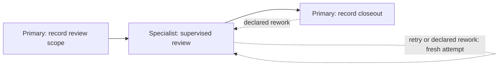

# Supervised Review Walkthrough

The [supervised-review-v2 Procedure](procedures/supervised-review-v2.yaml) shows
how a Primary prepares review input, supervises a Specialist, accepts the final
result, and closes the work. It is a custom learning example, not a built-in
preset. The [supervised-delegation specification](../specs/interfaces/supervised-delegation.md)
owns the behavior; the [roadmap](../roadmap/README.md#v2sdg-host-neutral-supervised-delegation-foundation)
owns release availability.

## What this example proves

The example runs against the real single Podway CLI with a deterministic
test executor. No model, Dolgorae service, credentials, or network access is
needed for the scenario. Source builds require the pinned Rust toolchain and
its build dependencies. The test does not qualify a live adapter or establish
that an installed stable release supports delegation.

The `fixture-specialist` binding, `reviewer` Role, and Role digest are synthetic
test data. The digest is SHA-256 of the UTF-8 JSON string `"reviewer-v1"`, without
a trailing newline, matching the existing qualification fixture. This string is
not a real immutable Role snapshot. Do not reuse the digest, generate a hash
from a real Role name, or submit fixture receipts for real work. A real
integration must resolve the exact Role-content and configuration identities
under its reviewed mapping, acknowledge the actual task, retain complete result
identity, and settle the worker. See the
[adapter mapping requirements](../implementation-tips/delegation-adapter-contract-review.md#integration-handoff).

## Graph and responsibilities



| Placement | Inputs and outputs | Completion condition |
| --- | --- | --- |
| `source` | Primary records bounded `input` text. | Required input is present and the action is unblocked. |
| `work` | Package selects `source.input`; Primary records accepted `result` and any optional `note`. | Current acceptance receipt plus ordinary item and blocker gates. |
| `closeout` | Primary reads `work.result` and records `closeout`. | Ordinary item and blocker gates; then the session completes. |

The declaration is on `graph.nodes` at `work`, not on its node definition.
`max_rounds: 3` bounds the reported round count. `after_accept: retain` requires
an idle worker before acceptance; choosing `release` in a real custom Procedure
requires completed release and `worker_disposition: released` instead.
The fixture's three rounds and feedback are simulated, not executed model work.

## Run the isolated test

From this source checkout on native Apple Silicon macOS, run:

```bash
make test-e2e-exact E2E_TEST=podway-cli::e2e_suite::e2e_v2sdg008_qualification::supervised_delegation_preserves_documented_example_hosts_and_recovery
```

This registered test builds and freezes the exact CLI and executes the example
plus the host and response-loss/restart scenarios. Its helper uses standalone
scratch Git worktrees and explicit worktree selectors, validates direct binary
and contract identities, and reaps its bounded children before removing owned
fixtures. It copies the linked YAML byte-for-byte and does not reconstruct the
graph or use an installed service, active user worktree or global skill as a fixture.

After the CLI is prepared, a shorter diagnostic runs only the example:

```bash
python3 tools/qualify_supervised_delegation.py \
  --podway target/debug/podway --scenario example
```

The helper verifies Output v4, version-result v2 and manifest v2, then runs only
the frozen CLI in its owned fixtures. Success uses
`podway.direct-delegation-qualification/v2` and reports `checks.example: true`,
the example source SHA-256 and canonical Procedure digest, CLI hash and direct
contract identity, and `runtime_cleanup: true`. `live_adapter` and `live_model` remain `not_performed`.
The complete development gate is still `make test`.

## Follow the command sequence

The test performs these authoring checks on its copied file, then previews it
and starts with the returned `procedure_digest`:

```bash
podway procedure format .podway/procedures/supervised-review-v2.yaml --check
podway procedure validate .podway/procedures/supervised-review-v2.yaml
podway procedure vet .podway/procedures/supervised-review-v2.yaml
podway procedure lint .podway/procedures/supervised-review-v2.yaml --warnings-as-errors
podway procedure check .podway/procedures/supervised-review-v2.yaml --warnings-as-errors
podway --json procedure preview .podway/procedures/supervised-review-v2.yaml
```

The following table explains the runtime operations executed by the isolated
helper. These are command tails, not commands to paste into an active workspace.
For manual use in a separately authorized workspace, preserve its exact CLI
and worktree selector and derive every mutation from fresh observation. Run
`observe --json` after each mutation. Every Procedure uses
`podway.observation-result/v5`, including delegated and Direct placements;
observation is one committed snapshot, not a queue barrier.

| Step | Command tail or external responsibility | Expected observation |
| --- | --- | --- |
| Admit | `start --procedure <relative-file> --expect-procedure-digest <preview-digest> --task <task> --idempotency-key <new-key>`, then fenced `begin` | Active `source` attempt. |
| Prepare | `set input <review-scope>`, then `complete` | Active `work`; `status.delegation.state` is `awaiting_acceptance`. |
| Read | `delegation package --json`; `evidence read --json --source source --item input` | Exact package digest and full selected input; follow paging tokens if truncated. |
| Supervise | Integration dispatches and records feedback; Primary judges the result. | Executor-acknowledged task, complete result, round count, and settled worker state. |
| Record | `set result <final-result>` and, if needed, `set note <final-note>` | Items ready; input package digest unchanged. |
| Accept | `delegation accept --stdin --json < acceptance.json` | `podway.delegation-accept-result/v2`; observation state `accepted`, same cursor and attempt. |
| Inspect | `delegation receipt --json --session <session-id> --attempt <attempt-id>` | `podway.delegation-receipt-result/v1` with current applicability. |
| Advance | Fenced `complete` | Active `closeout`; previous receipt is historical. |
| Close | Read selected `work.result`, `set closeout <conclusion>`, then `complete` | Session lifecycle `completed`. |

Item mutations use `--if-workspace-uuid`, `--if-session-id`, `--if-attempt`,
`--if-item-revision`, and a new `--idempotency-key`. Graph mutations use the
current `--if-session-revision` instead of an item revision; `begin` has no
active-attempt fence. Use the latest observation's `mutation_templates` and
command help rather than copying old values.

The acceptance document alone carries its fences and idempotency key; do not
also supply command-line identity flags. Use the
[acceptance field-source table](../../skills/use-podway/references/delegation.md#acceptance-field-sources)
and the [delegation specification](../specs/interfaces/supervised-delegation.md)
to assemble it. Require installed skill copies qualified for this direct
generation. The integration supplies external identities and digests; the
Primary supplies the decision. Podway computes the accepted item-state digest.
An optional note may remain unset, but adding it after acceptance changes the
accepted item state.

## Exercise failure and correction

The same YAML test also checks these paths:

| Case | Required outcome |
| --- | --- |
| Complete `work` before acceptance | `DELEGATION_RECEIPT_REQUIRED`; cursor does not advance. |
| Wrong Role, wrong package digest, or four rounds | `DELEGATION_BINDING_MISMATCH`; no receipt is accepted. |
| Record `note` after acceptance | `stale_acceptance`; completion returns `DELEGATION_RECEIPT_STALE`. |
| Replay the original acceptance | Original success may return, but the current receipt remains stale. |
| `retry --reason <reason>` or `rework --to work --reason <reason>` | Fresh attempt, `awaiting_acceptance`, unchanged external dispatch count. |
| Submit the old package with new attempt fences | `DELEGATION_BINDING_MISMATCH`; old work cannot be relabeled. |
| Revalidate for the fresh attempt, record final output, accept, and complete | Progress to closeout and terminal completion. |

Retry/rework does not promise another model call and does not decide whether an
artifact is reusable. The integration must reconcile uncertain external work
and explicitly validate any reused result against the new inputs and task
identity. For a lost acceptance response, keep the original request and key,
use `outcome lookup --idempotency-key <original-key>` and inspect current
readiness before completing. A not-found read after response loss is not proof
that the original writer has finished; reconcile it before identical retry. The existing
recovery scenarios test response loss and process restart independently.

## Adapt for real work

Use [delegation authoring guidance](../../skills/create-podway-procedure/references/delegation.md)
and the
[adapter mapping requirements](../implementation-tips/delegation-adapter-contract-review.md#integration-handoff)
to replace the synthetic binding and Role identity with a qualified mapping and
choose an appropriate round budget and worker disposition. Revalidate the exact
modified file and use its new preview digest. Record supported-release evidence
separately from source validation. The [real integration candidate](../todo/TODO-podway-supervised-delegation-integration.md)
tracks the remaining external and managed Primary prerequisites.
